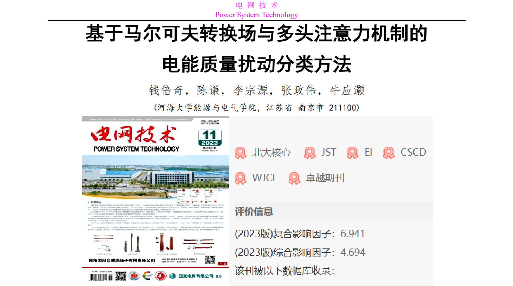
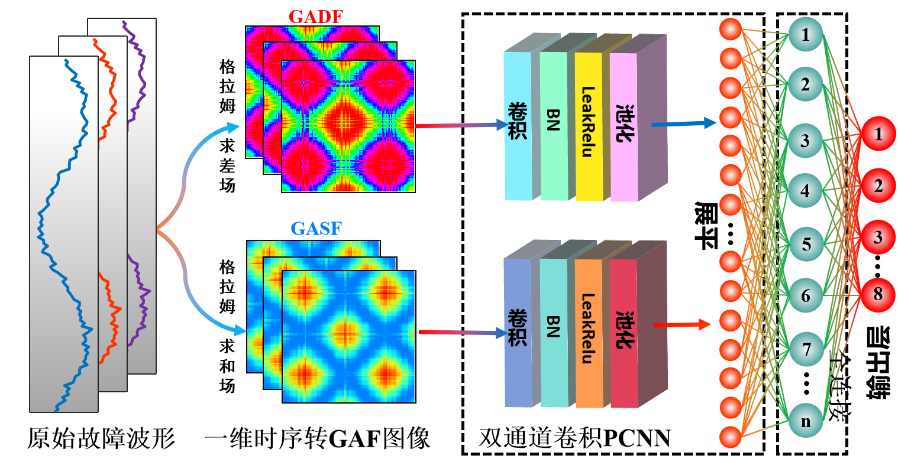
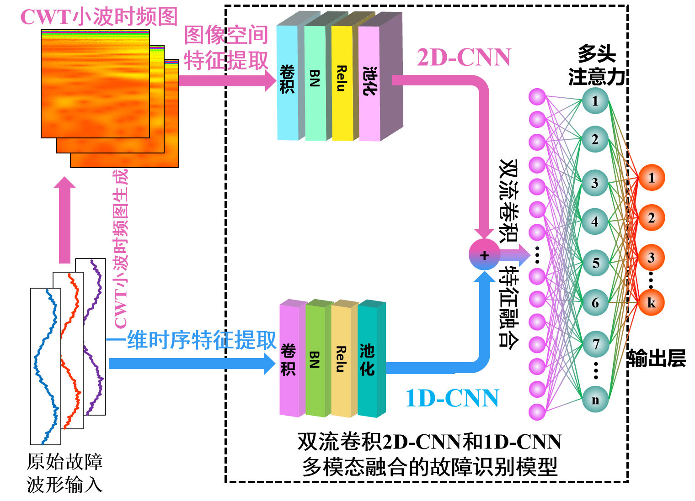
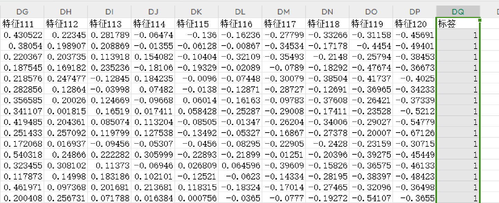
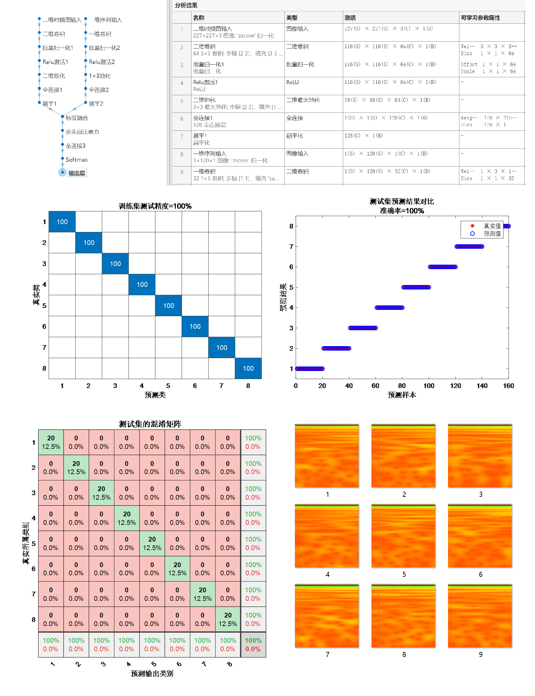
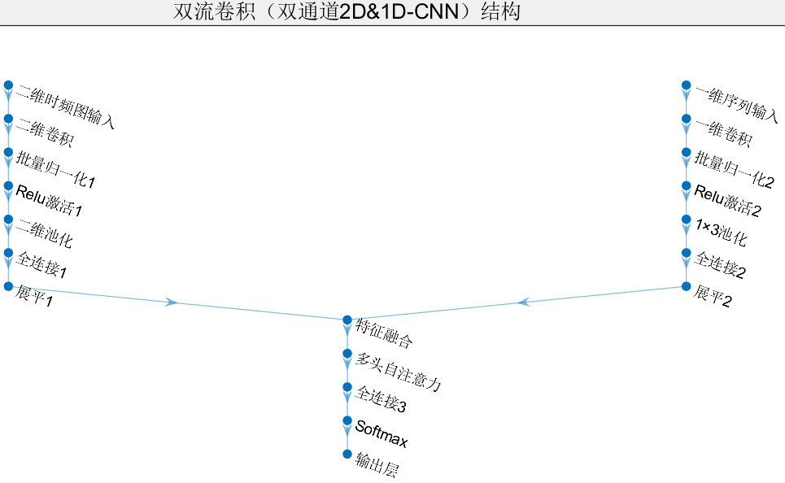
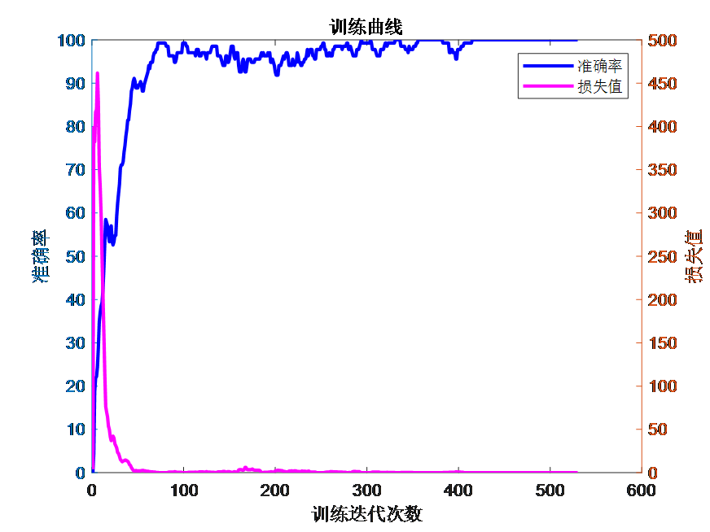

# Seven Innovations! Dual-Stream Convolution! CWT-DSCNN-MSA Based on Temporal Features and cwt Wavelet Time-Frequency Images for Dual-Stream Convolution Fusion Attention Mechanism in Fault Identification Program!

Platform: Matlab 2023 version and above

Documentation Interpretation: In this paper, the first step involves collecting time-series sequences of one-dimensional fault voltage and current signals. The second step is to transform these sequences using the Gram angle field, converting both one-dimensional time-series signals into Gram angle fields. Finally, two sets of images generated are fed into a CNN for parallel learning and training, achieving inverter fault diagnosis.

Model Improvement: Our proposed model makes multiple improvements on the aforementioned model: adopting a dual-branch structure that only requires raw fault waveform data to transform the one-dimensional sequence into two-dimensional wavelet cwt time-frequency images. One branch processes the input image through a 2D-CNN to extract wavelet time-frequency image features, while the other directly inputs the fault waveform into a 1D-CNN to extract time-series features. By fusing high-dimensional image features with one-dimensional time-series features, we construct a 1D-CNN and 2D-CNN (dual-stream convolution) model. The integration of multi-head attention mechanisms effectively captures the contribution of extracted features, enhancing feature emphasis and improving fault recognition accuracy. We also calculate evaluation metrics such as precision, recall, accuracy, F1 score, etc. The fault recognition process is as follows:

Seven Innovation Points:
1. Dual-stream Convolution: Integrating one-dimensional time-series signals and two-dimensional images, we can comprehensively utilize information from different modalities, thereby more comprehensively describing the characteristics of the data. This helps to extract richer and more discriminative features, thus increasing the accuracy of fault recognition by only requiring raw fault waveform data to transform one-dimensional sequences into two-dimensional cwt time-frequency images.
2. CWT Time-frequency Features: CWT time-frequency plots provide localized features in both time and frequency domains. They can effectively identify transient features or sudden changes in frequency components in fault signals, which are difficult to analyze in single-domain or frequency domain analysis alone.
3. Waveform Feature Extraction: 1D-CNN is more suitable for capturing local features and local patterns within sequences. In fault waveforms, many important features may concentrate in specific time periods, and 1D-CNN can better capture these temporally related local features.
4. Spatial Feature Learning: 2D-CNNs perform exceptionally well in image processing, effectively learning the spatial features and local patterns of images. Applying 2D convolutions to image data processing can help extract features such as texture, shape, and edges, which are beneficial for more accurate classification and fault identification.
5. Integration Advantage: By integrating information from different modalities, the algorithm can compensate for the limitations of one-dimensional time-series signals and two-dimensional images. For example, images may be more sensitive to certain fault patterns while sequential signals are more sensitive to others. Combining them can enhance the robustness and generalization ability of the algorithm.
6. Multi-head Self-Attention Mechanism: This mechanism effectively captures the contribution of feature extraction, focusing on enhancing key features to improve the accuracy of fault identification.
7. Enhance Generalization Ability: Multimodal fusion can help algorithms better understand the essential characteristics of data, thereby reducing the risk of overfitting and enhancing the algorithm's generalization ability on new data.
Applicable fields: Suitable for various data classification scenarios, such as rolling bearing faults, transformer oil gas faults, power system transmission line fault areas, insulators, distribution networks, and disturbances to power quality.
Simply replace the data, directly importing it into an Excel spreadsheet without significantly modifying the program. The program includes detailed comments for ease of understanding its operation.
Data format: Each row represents a sample, with the last column being the fault type label of the sample.
\n        \n      Result of the program: (Converted automatically from the above one-dimensional sequence into a cwt wavelet time-frequency image)
\n        \n      Shuangliu Model Structure:
\n        \n      Training Curve:
Subscribe to the editor for more high-quality learning materials, articles, and code!

## Images

<!-- PAYMENT_BLOCK -->

## Get this dataset

- Payment link (Stripe): [Buy now](https://buy.stripe.com/3cs8yP7sY87d0vu9AB)
- Payment QR code: 

<!-- /PAYMENT_BLOCK -->
